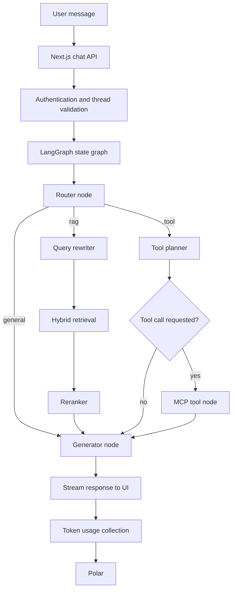

# AgentForge

AgentForge is an AI assistant platform built with Next.js, LangGraph, LangChain, and the Model Context Protocol (MCP). It routes user requests to general conversation, document-based retrieval, or external tools.

The platform includes PDF ingestion, hybrid dense and sparse retrieval, Reciprocal Rank Fusion (RRF), reranking, MCP-based tools, authentication, subscription checks, and LLM token usage tracking.

## Table of Contents

- [Features](#features)
- [Technology Stack](#technology-stack)
- [Architecture](#architecture)
- [Agent Workflow](#agent-workflow)
- [Document Ingestion](#document-ingestion)
- [Hybrid Retrieval](#hybrid-retrieval)
- [Query Rewriting](#query-rewriting)
- [Reranking and Answer Generation](#reranking-and-answer-generation)
- [MCP Tools](#mcp-tools)
- [Model Management](#model-management)
- [Authentication and Subscriptions](#authentication-and-subscriptions)
- [Token Usage Tracking](#token-usage-tracking)
- [Data Storage](#data-storage)
- [Retrieval Evaluation](#retrieval-evaluation)
- [Project Structure](#project-structure)
- [Getting Started](#getting-started)
- [Environment Variables](#environment-variables)
- [Available Scripts](#available-scripts)
- [Implementation Notes](#implementation-notes)
- [Security](#security)
- [License](#license)

## Features

- Three-way request routing for general chat, document retrieval, and external tools.
- PDF upload and document question answering.
- Dense semantic search and sparse keyword search.
- Pinecone Inference for dense and sparse embedding generation.
- Reciprocal Rank Fusion to combine retrieval results.
- Conditional query rewriting for multi-part and contextual questions.
- Pinecone Inference reranking before answer generation.
- MCP integration for web search, current weather, and product search.
- Model selection with subscription checks.
- Better Auth with email/password, Google, and GitHub sign-in.
- Polar integration for subscriptions and token usage events.
- PostgreSQL-backed application data and LangGraph checkpoint configuration.
- Retrieval evaluation using Recall@K, MRR@K, and nDCG@K.

## Technology Stack

| Area | Technologies |
|---|---|
| Application | Next.js, React, TypeScript |
| AI interface | Vercel AI SDK |
| Agent orchestration | LangGraph, LangChain |
| Chat models | Groq, Google Gemini |
| Embedding inference | Pinecone Inference API |
| Dense embedding model | `llama-text-embed-v2` |
| Sparse embedding model | `pinecone-sparse-english-v0` |
| Reranking model | `bge-reranker-v2-m3` |
| Vector database | Pinecone |
| Tool integration | Model Context Protocol |
| MCP server | Hono, MCP SDK, Streamable HTTP transport |
| Database | PostgreSQL |
| ORM and migrations | Drizzle ORM, Drizzle Kit |
| Authentication | Better Auth |
| Subscription and usage | Polar |
| Web search | Tavily |
| Weather | WeatherAPI |
| Product search | SerpApi / Google Shopping |
| Client state | Zustand |
| Styling | Tailwind CSS, shadcn/ui |

## Architecture

AgentForge uses a LangGraph state graph. Each node has a specific responsibility, and conditional edges select the workflow for the current request.

### Request flow



### Graph nodes

| Node | Responsibility |
|---|---|
| `routerNode` | Selects the `general`, `rag`, or `tool` route. |
| `queryRewriterNode` | Decides whether the latest document question needs rewriting and produces search queries when needed. |
| `hybridRetrievalNode` | Runs dense and sparse retrieval for the search queries and combines unique candidates. |
| `reRankerNode` | Reranks the candidate chunks against the original user question and builds the final context. |
| `toolPlannerNode` | Selects and prepares calls to the available MCP tools. |
| `mcpToolNode` | Executes tool calls using LangGraph's ToolNode. |
| `generatorNode` | Generates the final response using the selected chat model and the available context or tool results. |

The graph state is defined in `app/api/chat/state.ts`. It contains the conversation messages, route, rewritten queries, retrieved chunks, and generated context.

## Agent Workflow

### Request routing

The router first applies simple rules to identify clear cases:

- Explicit references to PDFs, documents, uploaded files, or attachments are sent to RAG.
- Follow-up messages remain on the RAG route when the previous assistant response appears to contain document citations or document-grounded content.
- Clear requests for live information, small talk, and certain coding requests can move away from the document route.
- When the rules do not decide the route, GPT-OSS 20B classifies the recent conversation using structured output.

If the routing model call fails, the router falls back to the general route.

### General requests

General requests go directly to the generator node. The generator uses the selected model and the general system prompt.

### Document requests

Document requests pass through query rewriting, hybrid retrieval, reranking, and answer generation. The RAG prompt instructs the model to answer from the retrieved excerpts and cite them using numbered references such as `[1]` and `[2]`.

### Tool requests

Tool requests pass through the tool planner. If the model returns tool calls, the MCP tool node executes them and the generator uses the returned tool results to prepare the final response.

## Document Ingestion

The PDF upload endpoint is `app/api/uploads/route.ts`. It requires an authenticated session and accepts PDF files up to 10 MB.

The ingestion implementation is in `lib/rag/ingest.ts`.

### Ingestion steps

1. Validate the authenticated user, file type, and file size.
2. Load the PDF text using LangChain's `PDFLoader`.
3. Split the extracted text with `RecursiveCharacterTextSplitter`.
4. Generate dense and sparse embeddings in parallel.
5. Create matching chunk IDs and metadata for both vector representations.
6. Upsert records into the dense and sparse Pinecone indexes.
7. Store records in a namespace derived from the authenticated user ID.

### Chunking and batching

| Setting | Value |
|---|---|
| Accepted file type | PDF |
| Maximum file size | 10 MB |
| Chunk size | 800 characters |
| Chunk overlap | 150 characters |
| Text splitter | RecursiveCharacterTextSplitter |
| Embedding batch size | 96 |
| Pinecone upsert batch size | 100 records |
| Chunk ID format | `<docId>#<chunkIndex>` |

The chunk metadata contains the extracted text, source filename, document ID, and chunk index.

### Embedding models

Both embedding models are called through Pinecone Inference.

**Dense embeddings**

| Setting | Value |
|---|---|
| Model | `llama-text-embed-v2` |
| Vector type | Dense |
| Default dimensions | 1024 |
| Document input type | `passage` |
| Query input type | `query` |
| Truncation | `END` |
| Batch size | 96 |

The dense model creates semantic vectors used to find passages with related meaning.

**Sparse embeddings**

| Setting | Value |
|---|---|
| Model | `pinecone-sparse-english-v0` |
| Vector type | Sparse |
| Document input type | `passage` |
| Query input type | `query` |
| Truncation | `END` |
| Batch size | 96 |

Sparse vectors support keyword-oriented retrieval. The dense and sparse embedding operations run concurrently during ingestion and query embedding.

The dense index must be configured with a dimension compatible with the model output. The current code does not pass a custom dimension parameter to the inference request, so the model's default output dimension is used.

### Pinecone index and namespace layout

The application uses two Pinecone indexes:

- A dense index configured for dense vectors.
- A sparse index configured for sparse vectors.

Both indexes use the same chunk IDs. User data is separated by namespaces in the format `user_<userId>`.

```text
Pinecone
├── Dense index
│   └── user_<userId>
│       └── document chunks
└── Sparse index
    └── user_<userId>
        └── document chunks
```

When changing embedding models or vector dimensions, existing documents should be re-embedded and stored in indexes compatible with the new vectors.

## Hybrid Retrieval

Hybrid retrieval is implemented in `lib/rag/retrieve.ts`.

For each search query:

1. Generate a dense query vector.
2. Generate a sparse query vector.
3. Query the dense and sparse indexes concurrently.
4. Retrieve up to 20 candidates from each index.
5. Combine the rankings using Reciprocal Rank Fusion.
6. Sort the fused results and return up to 15 chunks.

### Reciprocal Rank Fusion

The implementation uses the following formula:

```text
RRF(d) = Σ 1 / (k + rank(d))
```

The configured constant is `k = 60`. A chunk appearing in both result lists receives a contribution from each ranking. The fused results are sorted by their combined score.

When query rewriting produces multiple queries, the hybrid retrieval node runs retrieval for those queries concurrently and pools the returned chunks by ID before reranking.

## Query Rewriting

Conditional query rewriting is implemented in `app/api/chat/nodes/queryRewriter.ts.ts`.

The node does not call an LLM for every document question. It first checks whether the latest message needs rewriting.

It looks for:

- Multi-part questions.
- Filler phrases and document references that can be removed.
- Follow-up questions that depend on earlier messages.
- Short questions that may not be self-contained when conversation history exists.

If rewriting is not needed, the original question is used directly.

When rewriting is needed, GPT-OSS 20B uses structured output to produce between one and three search queries. The node uses recent conversation history, clips each history message to 300 characters, removes empty and duplicate queries, and limits non-multi-part questions to one query.

If rewriting fails, the original question is used as a fallback.

## Reranking and Answer Generation

Reranking is implemented in `lib/rag/reranker.ts` and called by `app/api/chat/nodes/reranker.ts`.

| Setting | Value |
|---|---|
| Model | `bge-reranker-v2-m3` |
| Provider | Pinecone Inference API |
| Input | Original question and retrieved chunk text |
| Maximum reranker output | 10 chunks |
| Context passed to generator | Up to 8 chunks |

The reranker scores the candidate chunks against the original user question and returns them in relevance order.

The graph node formats the top eight chunks as numbered excerpts, including their source filenames. The generator receives this context with a prompt that instructs it to:

- Answer only from the supplied excerpts.
- Cite excerpts using their numbered references.
- Avoid using general knowledge to fill missing document information.
- State when the answer cannot be found in the retrieved excerpts.

## MCP Tools

AgentForge uses the Model Context Protocol to expose external services to the agent.

The MCP server is implemented in `lib/mcp/server.ts`. It uses Hono and Streamable HTTP transport and exposes its tools at `/services` on port `8080`.

The application connects through `lib/mcp/client.ts`, using the `MCP_SERVER_URL` environment variable. The MCP client discovers the available tools and caches the tool list in the application process.

### Available tools

| MCP tool | Service | Purpose |
|---|---|---|
| `web_searchTool` | Tavily | Searches the web for current information and news. |
| `weather_Search` | WeatherAPI | Retrieves current weather conditions for a location. |
| `productTool` | SerpApi / Google Shopping | Searches for products, prices, sellers, ratings, and shopping links. |

The weather integration returns current conditions, not a forecast. The product integration returns structured shopping results when available. The web search integration returns a limited set of source details for the generator to use.

The Next.js application and MCP server run as separate processes.

## Model Management

The backend model registry is defined in `app/api/chat/model.ts`.

### Models registered in the backend

| Model ID | Provider | Access tier |
|---|---|---|
| `openai/gpt-oss-120b` | Groq | Free |
| `openai/gpt-oss-20b` | Groq | Free |
| `gemini-3.1-pro-preview` | Google | Subscription |

GPT-OSS 20B is used for routing and query rewriting, and is bound to the MCP tools for tool planning. The generator uses the model selected for the conversation.

The default generator model is `openai/gpt-oss-120b`. If a subscription-only backend model is selected without an active subscription, the backend resolves the request to the default model.

The frontend model selector uses Zustand to store the selected model. Subscription status is loaded in the chat layout and passed to the selector.

**Model availability note:** The frontend selector also lists Claude Sonnet, but Claude is not included in the backend model registry. The backend currently rejects model IDs that are not registered. Claude should therefore be considered a displayed but not yet supported option.

## Authentication and Subscriptions

### Authentication

Better Auth is configured in `lib/auth.ts` with Drizzle ORM and PostgreSQL.

The configured sign-in methods are:

- Email and password.
- Google OAuth.
- GitHub OAuth.

The chat and upload endpoints check the user's session. The chat endpoint also checks that an existing conversation thread belongs to the authenticated user.

### Polar integration

Polar is integrated through the Better Auth Polar plugin. The current configuration includes customer creation on signup, checkout, customer portal, and usage support.

The subscription lookup checks for subscriptions with an `active` or `trialing` status. The current Polar client configuration uses the sandbox environment; configure the appropriate environment and credentials before production use.

## Token Usage Tracking

Token tracking is implemented in `lib/polar/trackTokenusuage.ts`.

The application reads chat-model completion events from the LangGraph event stream and collects input and output token counts when usage metadata is available. It then sends an `llm_tokens` event to Polar with the model identifier and token totals.

**Accounting note:** The current tracker aggregates token usage across the stream and submits the aggregate using the resolved selected generator model ID. Since internal nodes can call GPT-OSS 20B separately, the recorded model attribution may not distinguish internal model usage from generator usage.

## Data Storage

| Component | Responsibility |
|---|---|
| PostgreSQL | Stores application and authentication data. |
| Drizzle ORM | Defines database access and migrations. |
| Better Auth | Stores users, sessions, accounts, and verification data. |
| Thread table | Stores conversation thread ownership and titles. |
| LangGraph PostgresSaver | Configured as the graph checkpointer. |
| Pinecone dense index | Stores dense document vectors and metadata. |
| Pinecone sparse index | Stores sparse document vectors and metadata. |
| Polar | Stores subscription and usage event data. |

The graph creates a `PostgresSaver` using `DATABASE_URL`. The call to `PostgresSaver.setup()` is currently commented out. Initialize the checkpointer tables before relying on checkpoint persistence if they have not already been created.

## Retrieval Evaluation

The repository includes a retrieval evaluation script in the `eval/` directory.

| File | Purpose |
|---|---|
| `eval/questions.json` | Evaluation questions and manually assigned relevant chunk IDs. |
| `eval/metrics.ts` | Recall@K, MRR@K, and nDCG@K implementations. |
| `eval/run-retrieval-eval.ts` | Runs hybrid retrieval and compares rankings before and after reranking. |
| `eval/results/` | Stores per-question evaluation reports. |

The script evaluates the same hybrid retrieval candidates before and after reranking. It reports:

- **Recall@5:** The proportion of labelled relevant chunks found in the top five results.
- **MRR@10:** The reciprocal rank of the first relevant chunk within the top ten.
- **nDCG@10:** Ranking quality using the graded relevance labels in the evaluation set.

### Previously recorded benchmark

The repository contains a saved report from October 28, 2026, with 35 evaluation questions.

| Metric | Hybrid retrieval | After reranking |
|---|---:|---:|
| Recall@5 | 0.90 | 0.96 |
| MRR@10 | 0.80 | 0.96 |
| nDCG@10 | 0.80 | 0.88 |

These are results from the saved benchmark run. They predate the November 2026 dense embedding migration and should not be presented as measured results for the current embedding configuration.

### Run the evaluation

Make sure the evaluation PDF has been ingested into Pinecone and that the evaluation user namespace contains the matching chunk IDs.

Set the user ID in the environment:

```env
EVAL_USER_ID=YOUR_USER_ID
```

Then run:

```bash
pnpm exec tsx eval/run-retrieval-eval.ts
```

The script reads `eval/questions.json`, runs retrieval and reranking, prints the average metrics, and writes a timestamped JSON report to `eval/results/`.

The script does not ingest the PDF. It evaluates the vectors and chunk IDs that are already stored in Pinecone.

## Project Structure

```text
AgentForge/
├── app/
│   ├── (chat)/
│   ├── api/
│   │   ├── auth/
│   │   ├── chat/
│   │   │   ├── nodes/
│   │   │   │   ├── router.ts
│   │   │   │   ├── queryRewriter.ts.ts
│   │   │   │   ├── hybridRetrieval.ts
│   │   │   │   ├── reranker.ts
│   │   │   │   ├── tool_Planner.ts
│   │   │   │   ├── mcpToolNode.ts
│   │   │   │   ├── generator.ts
│   │   │   │   └── evaluator.ts
│   │   │   ├── graph.ts
│   │   │   ├── model.ts
│   │   │   ├── prompts.ts
│   │   │   ├── route.ts
│   │   │   ├── state.ts
│   │   │   ├── tool.ts
│   │   │   └── toolregistry.ts
│   │   └── uploads/
│   ├── auth/
│   └── layout.tsx
├── components/
│   ├── ai-elements/
│   ├── genui/
│   ├── sidebar/
│   └── ui/
├── db/
│   ├── schema/
│   └── index.ts
├── drizzle/
├── eval/
│   ├── questions.json
│   ├── metrics.ts
│   ├── run-retrieval-eval.ts
│   └── results/
├── lib/
│   ├── mcp/
│   │   ├── client.ts
│   │   └── server.ts
│   ├── polar/
│   │   ├── polar_ingestion.ts
│   │   └── trackTokenusuage.ts
│   ├── rag/
│   │   ├── embeeding.ts
│   │   ├── ingest.ts
│   │   ├── pineconeD.ts
│   │   ├── retrieve.ts
│   │   └── reranker.ts
│   ├── auth.ts
│   ├── auth-client.ts
│   ├── conversationHistory.ts
│   └── convertorfile.ts
├── store/
│   ├── data-store.ts
│   └── model-store.ts
├── docker-compose.yaml
├── drizzle.config.ts
├── package.json
└── README.md
```

## Getting Started

### Prerequisites

- Node.js compatible with the installed Next.js version.
- pnpm.
- PostgreSQL.
- Pinecone account with dense and sparse indexes.
- Groq API key.
- Google API key if using Gemini.
- Google and GitHub OAuth credentials if using social sign-in.
- Polar credentials.
- Tavily, WeatherAPI, and SerpApi credentials for the corresponding MCP tools.
- ngrok if the MCP server needs to be exposed through a public HTTPS URL for remote access.

### 1. Clone the repository

```bash
git clone https://github.com/devtanishq-tech/AgentForge-AI-Agentic-AI-SaaS-Platform.git
cd AgentForge-AI-Agentic-AI-SaaS-Platform
```

### 2. Install dependencies

```bash
pnpm install
```

### 3. Configure environment variables

Create a `.env` file in the project root and add the variables required by the services you use. See [Environment Variables](#environment-variables).

### 4. Configure Pinecone

Create a dense index compatible with the 1024-dimensional output of the current dense embedding model, and a sparse index for sparse vectors.

Set both index names and the Pinecone API key in `.env`.

If you are moving from the previous 384-dimensional dense model, do not reuse incompatible vectors. Create or configure the correct dense index and re-ingest the documents using the current embedding model.

### 5. Start PostgreSQL

The repository includes a Docker Compose service using the `pgvector/pgvector:pg16` image.

```bash
docker compose up -d
```

The default local Compose configuration creates a database named `mydb` with the user and password set in `docker-compose.yaml`. Update these values for your environment and set `DATABASE_URL` accordingly.

Apply Drizzle migrations:

```bash
pnpm run migration:migrate
```

Initialize the LangGraph checkpointer tables if they have not already been created.

### 6. Start the MCP server

In a separate terminal:

```bash
pnpm run mcp:dev
```

The MCP endpoint is:

```text
http://localhost:8080/services
```

### 7. Configure MCP connectivity

For local development, set:

```env
MCP_SERVER_URL=http://localhost:8080/services
```

If the Next.js application cannot reach the local MCP server directly, expose port 8080 with ngrok:

```bash
ngrok http 8080
```

Use the generated HTTPS address with `/services` appended as the value of `MCP_SERVER_URL`. Keep the MCP server and tunnel running while using external tools.

### 8. Start the Next.js application

In another terminal:

```bash
pnpm run dev
```

Open [http://localhost:3000](http://localhost:3000) in your browser.

## Environment Variables

| Variable | Purpose |
|---|---|
| `DATABASE_URL` | PostgreSQL connection string. |
| `BETTER_AUTH_URL` | Base URL for Better Auth. |
| `GROQ_API_KEY` | Groq chat model access. |
| `GOOGLE_API_KEY` | Google Gemini model access. |
| `GOOGLE_CLIENT_ID` | Google OAuth client ID. |
| `GOOGLE_CLIENT_SECRET` | Google OAuth client secret. |
| `GITHUB_CLIENT_ID` | GitHub OAuth client ID. |
| `GITHUB_CLIENT_SECRET` | GitHub OAuth client secret. |
| `PINECONE_KEY` | Pinecone API key. |
| `PINECONE_INDEX_NAME` | Dense Pinecone index name. |
| `PINECONE_SPARSE_INDEX_NAME` | Sparse Pinecone index name. |
| `TAVILY_SEARCH_API` | Tavily API key. |
| `WEATHER_API_KEY` | WeatherAPI key. |
| `SERP_API_KEY` | SerpApi key. |
| `POLAR_ACCESS_TOKEN` | Polar access token. |
| `MCP_SERVER_URL` | MCP endpoint URL ending in `/services`. |
| `EVAL_USER_ID` | Optional user ID for the retrieval evaluation script. |

The repository does not currently include an `.env.example` file. The table lists the environment variables referenced by the reviewed implementation.

## Available Scripts

| Command | Description |
|---|---|
| `pnpm install` | Install dependencies. |
| `pnpm run dev` | Start the Next.js development server. |
| `pnpm run mcp:dev` | Start the MCP server. |
| `pnpm run build` | Build the Next.js application. |
| `pnpm run start` | Start the production Next.js server. |
| `pnpm run lint` | Run ESLint. |
| `pnpm run migration:generate` | Generate Drizzle migrations. |
| `pnpm run migration:migrate` | Apply Drizzle migrations. |
| `pnpm exec tsx eval/run-retrieval-eval.ts` | Run retrieval evaluation. |

## Implementation Notes

- The dense embedding model changed from the previous local `Xenova/all-MiniLM-L6-v2` implementation to Pinecone Inference with `llama-text-embed-v2`.
- The current dense embedding code uses the model's default 1024-dimensional output.
- The sparse embedding implementation uses Pinecone's `pinecone-sparse-english-v0` model.
- Existing documents need to be re-ingested after an embedding model or vector dimension change.
- The saved October 2026 retrieval benchmark predates the current dense embedding configuration.
- The graph checkpointer is constructed, but the setup call is commented out.
- Claude Sonnet appears in the frontend selector but is not registered in the backend model registry.
- Token usage is aggregated across the chat stream and attributed to the resolved selected model ID. Internal model calls may therefore not be attributed to their individual models.
- The MCP server is a separate process and must be available for external tool execution.
- The `evaluatorNode` source file is currently empty and is not registered as an active graph node.

## Security

- Keep API keys, OAuth secrets, database credentials, and Polar tokens in environment variables.
- Do not commit `.env` files.
- Require authentication before accessing protected chat and upload endpoints.
- Verify thread ownership before returning or continuing a conversation.
- Protect the MCP endpoint when exposing it outside the local development environment.
- Avoid logging API credentials or private document contents.

## License

No `LICENSE` file was found in the repository during this review. Add a license file if you want to define how others may use, modify, and distribute the project.
